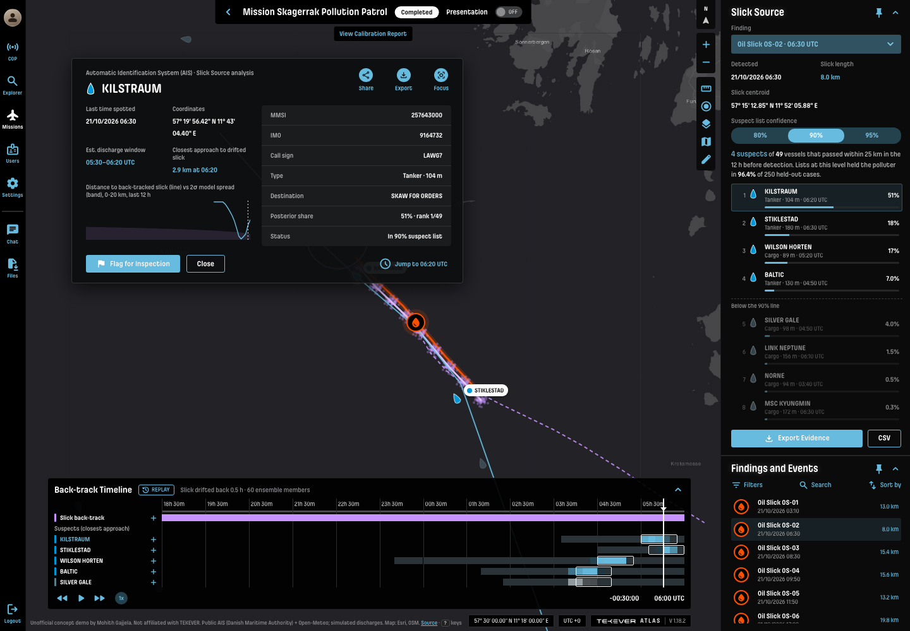

# Slick Source for TEKEVER ATLAS

**Live demo:** https://mohith26.github.io/tekever-slick-source/

When an AR5 on an EMSA or coast-guard patrol spots an oil slick, the next question is "which ship did this?" Slick Source drifts the observed slick backwards through real wind and surface-current data, scores every vessel in the AIS picture by whether its track lines up with the back-drifted slick (shape and timing), and returns a **suspect list with a stated miss rate**: at the 90% setting, the list contains the polluter at least 90% of the time (split conformal prediction), so an inspector knows how much to trust a short list before boarding anyone.



*Unofficial concept demo by Mohith Gajjela. Not affiliated with TEKEVER. AIS is real public data; the oil discharges are simulated (see Limitations).*

## Results (held-out, computed by `scripts/build_data.mjs`, stored in `data/results.json`)

700 discharges were simulated from real vessels in the Danish Maritime Authority AIS feed for 21 Oct 2026 (Kattegat/Skagerrak, 510 vessels with tracks) and drifted with hidden "true" parameters through Open-Meteo wind and currents. 200 cases fit the posterior temperature, 250 calibrate the conformal threshold, 250 are held out.

| Target confidence | Held-out coverage | Mean list size | Median | 90th pct |
|---|---|---|---|---|
| 80% | 83.6% | 6.48 | 6 | 14 |
| 90% | 96.4% | 9.11 | 8 | 19 |
| 95% | 97.6% | 10.79 | 10 | 22 |

- Average vessels within 25 km in the 12 h search window: **101.2**.
- Top-1 accuracy: **35.6%** for the ranked list vs **8.0%** for "the vessel nearest the slick" (a rule-style baseline).
- Headline: the 90% suspect list averaged **9.11 vessels out of 101.2** and contained the polluter in **96.4%** of held-out cases.

## How it works

1. **Drift field** (`core/drift.js`): hourly 10 m wind (Open-Meteo historical) and surface current (Open-Meteo marine) at 20 points, inverse-distance weighted in space and linear in time. Oil drift = κ·current + bias + α·wind rotated θ clockwise.
2. **Ensemble back-tracking:** 60 members drawn from wide priors (α 2-4.5%, θ 0-25°, κ ~ N(1, 0.3), bias ~ N(0, 0.06 m/s)); each carries the 9 observed slick-axis points back 12 h in 10-minute RK2 steps.
3. **Shape-aware track likelihood:** for each member, a vessel must pass *every* slick point within one short discharge window (≤ 5 steps); point-to-segment distances against the AIS track with a Gaussian kernel that widens with age (250 m + diffusion). Members share their drift error, so the slick's shape survives back-tracking even when its absolute position does not. Log-mean-exp over windows and members gives each vessel a log-likelihood.
4. **Calibration:** posterior = softmax(logLik / T) with T fit by maximum likelihood on a separate set; conformal APS-style score = posterior mass ranked above the true vessel; threshold = the ⌈(n+1)(1-α)⌉-th calibration score. The list is the ranked prefix below the threshold, never empty.
5. **App:** a Missions-replay screen in the ATLAS shell. Pick a slick finding, choose 80/90/95%, scrub the back-track timeline to watch the ensemble drift backwards, open a vessel card (estimated discharge window, closest approach, distance-vs-spread chart), flag vessels for inspection (persisted in localStorage), export the evidence pack (JSON) or ranked list (CSV). Deep links: `#e=E458&conf=90&v=257643000&k=3&card=1`. Keys: ↑/↓, Enter, F, E, ←/→, Space, 1/2/3, [ ], V, ?.

## Tests

`node --test tests/core.test.mjs` (15 tests, also run by GitHub Actions): data integrity, RNG determinism, projection round-trip vs haversine (randomized), wind/current direction conventions, interpolation exactness, back-then-forward reversibility on real fields (randomized), windage/deflection geometry, segment distance, APS set/score agreement + prefix + monotonicity (randomized), conformal coverage on exchangeable scores (randomized), temperature fitting recovers a known T, the joint score prefers the true polluter over a parallel ship and a late ship, **every showcase result in `results.json` is reproduced by the app's pipeline**, headline numbers match the table, and timeline profiles are null exactly where AIS is missing.

## Run it

```
python3 -m http.server   # then open http://localhost:8000
node scripts/build_data.mjs   # rebuilds data/*.json from raw/ (about 20 s)
node --test tests/core.test.mjs
```

## Limitations (honest)

- **Discharges are simulated.** The vessels, tracks and weather are real; the labels are not. The coverage guarantee holds for new slicks from the same simulator. For real use the threshold must be recalibrated on confirmed cases, e.g. CleanSeaNet verification feedback from Member States.
- The simulator's "truth" uses the same wind/current fields with perturbed parameters, so real forecast error (especially coastal currents, Stokes drift, sub-grid eddies) is likely larger than modelled. Open-Meteo's current product is coarse.
- One day of AIS and a single region; vessels with AIS off are invisible (the dark-vessel case needs SAR/EO detections as extra candidates).
- 10-minute AIS resampling with linear interpolation; 25 km candidate radius; slick observed as a 9-point principal axis (an EO/IR detector would give an outline).
- The 80% level's 83.6% and 90% level's 96.4% are conservative because scores tie at the top; this is expected with a non-randomised score.
- Current direction is treated as "towards" (oceanographic) and wind as "from" (meteorological), per Open-Meteo's documentation.

## Prior art / novelty

EMSA's CleanSeaNet already "contributes to the identification of polluters" by correlating AIS tracks with satellite-detected slicks, using operator analysis and rule-based culprit alerts ("vessel connected", "track matches spill's shape"), and academic oil-spill back-tracking models exist (e.g. MEDSLIK-II backward mode). I found no TEKEVER page, ATLAS material or news item describing polluter attribution in ATLAS, and no public tool that returns a **calibrated suspect set with a stated coverage guarantee** from drone-detected slicks. Checked: tekever.com/atlas, tekever.com news index (2020-Nov 2026), EMSA CSN catalogue and service pages, searches for "Tekever oil spill polluter AIS", "CleanSeaNet possible polluter backtracking", "oil slick backtracking AIS polluter ranking probability".

## Data

- AIS: Danish Maritime Authority, http://aisdata.ais.dk (free, open). `raw/kat.csv` is a thinned subset.
- Weather: Open-Meteo historical + marine APIs (CC BY 4.0).
- Map tiles: Esri World Dark Gray Canvas.
